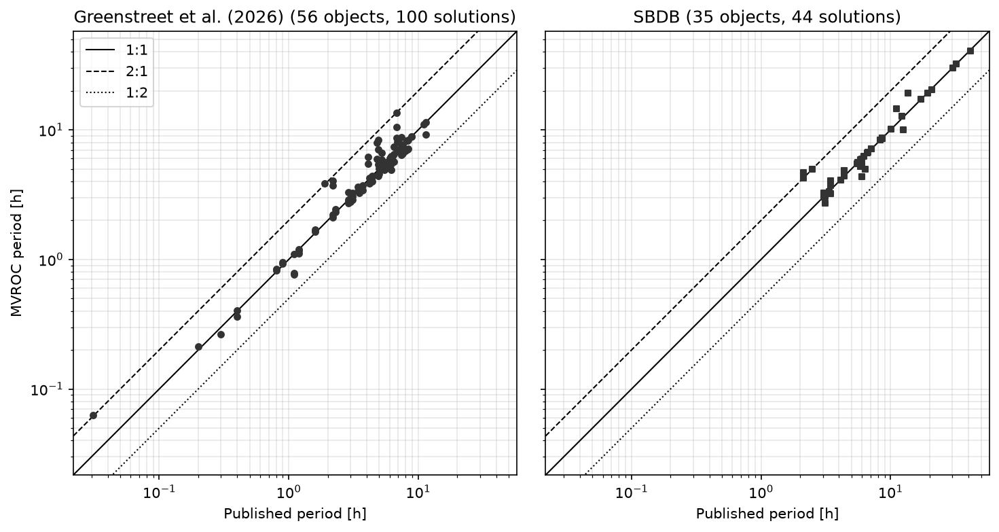

# Medellin VRO Catalogue

[](https://doi.org/10.5281/zenodo.23486386)

The Medellín Vera Rubin Observatory Catalogue (MVROC) is a catalogue of photometric and dynamical properties of Solar System small bodies measured in the public Rubin observations reported to the Minor Planet Center. Each row of [mvroc.csv](mvroc.csv) is one retained rotation solution. An asteroid can contribute more than one row when more than one period folds the data well.

The table joins the designation, the time span and the number of measurements in each LSST filter, the orbit, mean absolute magnitudes, phase-corrected colours, a photometric taxonomic label, the adopted rotation period, two shape fits on the synthetic channel Lk, light-curve classification, physical properties from the JPL Small-Body Database, rotation periods from Greenstreet et al. (2026), and dynamical quantities (population class, Tisserand parameters, and a Jupiter-resonance flag). A missing value is NaN.

## Scientific team

The catalogue was built by Team 5 at [Open Tools, Open Sky: Doing LSST Science with Public Rubin Data & LINCC Frameworks](https://plazasmalagon.com/lsst-science-public-rubin-data-products-hackathon-UdeA-2026/), a LATAM Hack Days workshop held in person at the Universidad de Antioquia, Medellín, Colombia, on 13–15 October 2026.

- Jorge Iván Zuluaga Callejas, Universidad de Antioquia, Colombia
- Juanita Andrea Agudelo, Universidad de Antioquia, Colombia
- Nicolás Pan, Universidad de la República, Uruguay
- Valeria Judith Burgoa Camacho, Universidad Mayor de San Andrés, Bolivia
- Angie Melissa Gutiérrez Estupiñán, Universidad Industrial de Santander, Colombia
- Pedro Bernardinelli, mentor, Universidade de São Paulo, Brazil


*From left to right: Jorge, Juanita, Vale, Nico, and Angie, with Pedro behind them. Behind the group are the city of Medellín, the Universidad de Antioquia station of the Medellín Metro, and the dome of the Planetario de Medellín observatory.*

## Catalogue fields

The public table is [mvroc.csv](mvroc.csv): 1 092 solutions, 99 columns, 703 asteroids. Column meanings are in [CATALOGUE.md](CATALOGUE.md). The fields are grouped as follows.

1. **Identification** — `provid`, `solution_id`, `permid`, `mpc_designation`
2. **Observations** — `epoch_utc_ini`, `epoch_utc_end`, `n_obs`, `n_obs_u`, `n_obs_g`, `n_obs_r`, `n_obs_i`, `n_obs_z`, `n_obs_y`
3. **Orbit** — `epoch_tdb`, `a`, `e`, `q`, `incl`, `node`, `peri`, `M`
4. **Mean absolute magnitudes** — `H_u`, `H_g`, `H_r`, `H_i`, `H_z`, `H_y`
5. **Phase-corrected colours** — `u-g`, `u-g_err`, `u-r`, `u-r_err`, `g-r`, `g-r_err`, `r-i`, `r-i_err`, `i-z`, `i-z_err`, `z-y`, `z-y_err`
6. **Photometric taxonomy** — `gri_slope`, `photo_spec_T`
7. **Adopted solution** — `p_rot_h`, `chi2_nu`
8. **Multiband Lk** — `amp_lsm_k`, `amp_photo_k`, `rms_multi`, `n_outliers_multi`
9. **Shape, spheres** — `q_sph_k`, `q_sph_err_k`, `phi_sph_deg_k`, `phi_sph_err_deg_k`, `chi_r_sph_k`, `amp_sph_k`, `m_mid_sph_k`, `m_sep_k`, `p_rot_sph_h_k`
10. **Shape, ellipsoid** — `b_over_a_k`, `b_over_a_err_k`, `amp_ell_k`, `m_mid_ell_k`, `m_ab_k`, `p_rot_ell_h_k`, `chi_r_ell_k`
11. **Classification** — `tags`, `Q`, `use_band`
12. **SBDB** — `H_sbdb`, `H_sbdb_err`, `albedo_sbdb`, `albedo_sbdb_err`, `diameter_sbdb`, `diameter_sbdb_err`, `extent_sbdb`, `extent_sbdb_err`, `pole_sbdb`, `pole_sbdb_err`, `density_sbdb`, `density_sbdb_err`, `rot_per_sbdb`, `rot_per_sbdb_err`, `GM_sbdb`, `GM_sbdb_err`, `BV_sbdb`, `BV_sbdb_err`, `UB_sbdb`, `UB_sbdb_err`, `spec_B_sbdb`, `spec_B_sbdb_err`, `spec_T_sbdb`, `spec_T_sbdb_err`
13. **Greenstreet** — `rot_per_lsm_gst`, `rot_per_fr_gst`
14. **Dynamics** — `dyn_class`, `T_earth`, `T_mars`, `T_jup`, `T_nep`, `flag_resonant`, `resonant_ratio`

## Pipeline results

First pipeline run: **4 November 2026**, on the Rubin MPC observation table downloaded **12 October 2026** (8 078 546 rows). The large parquet tables are in [this Google Drive folder](https://drive.google.com/drive/folders/1l99VF8mxHfaqc82aR4SSCKunrfRnXzCZ?usp=sharing).

| File | Format | Rows | Role |
|---|---|---:|---|
| `obs_sbn_X05_full.parquet` | Parquet | 8 078 546 | Original Rubin MPC observations (12 October 2026). On Google Drive. |
| `db_vro_mpc.csv` | CSV | 300 952 | Rubin ↔ MPC equivalence |
| `db_mvroc_orbits.csv` | CSV | 298 225 | Orbital elements per MPC object |
| `db_mvroc_state.parquet` | Parquet | 8 021 267 | Per-observation geometry and absolute magnitude. On Google Drive. |
| `db_mvroc_moi.parquet` | Parquet | 1 962 044 obs (8 000 objects) | MOI: objects with at least 100 observations. On Google Drive. |
| `db_mvroc_moc.csv` | CSV | 703 | MOC: objects kept after visual review of the folded light curves |
| `db_mvroc_sol.csv` | CSV | 1 092 | Rotation solutions kept by a second visual inspection |
| `mvroc.csv` | CSV | 1 092 | Public catalogue, one row per solution |

The MOI cut keeps 8 000 MPC objects (8 010 Rubin designations). Visual review of the folds keeps 703 asteroids (MOC). A second inspection keeps the periods that fold the data well: 1 092 solutions (386 objects with one solution, 248 with two, 66 with three, and 3 with four). Periods run from 0.063 h to 44.1 h (median about 4.85 h). The photometry spans 2025-04-22 to 2026-04-15.

| Quantity | Value |
|---|---|
| Unique objects | 703 |
| Orbits filled (`a`) | 100% |
| `H_r` filled | 98.8% |
| Shape `q_sph_k` filled | 99.5% |
| Greenstreet period match | 56 objects (100 solutions) |
| SBDB `rot_per` match | 35 objects (44 solutions) |

No object is in both literature lists, so 91 objects have a published period in either source.

## How to use the catalogue

`p_rot_h` is the adopted MVROC period, in hours. `rot_per_sbdb` is the JPL Small-Body Database period. `rot_per_lsm_gst` is the Lomb–Scargle period of Greenstreet et al. (2026). Several solutions of the same asteroid share the published period. The notebook [quickstart.ipynb](quickstart.ipynb) draws this comparison and is the place for further figures.

```python
import matplotlib.pyplot as plt
import numpy as np
import pandas as pd

catalogue = pd.read_csv("mvroc.csv")

sbdb = catalogue.dropna(subset=["p_rot_h", "rot_per_sbdb"])
greenstreet = catalogue.dropna(subset=["p_rot_h", "rot_per_lsm_gst"])

fig, axes = plt.subplots(1, 2, figsize=(10, 5), sharex=True, sharey=True)
panels = (
    (axes[0], greenstreet, "rot_per_lsm_gst", "o", "Greenstreet et al. (2026)"),
    (axes[1], sbdb, "rot_per_sbdb", "s", "SBDB"),
)
for ax, part, column, marker, title in panels:
    x = part[column].to_numpy(float)
    y = part["p_rot_h"].to_numpy(float)
    ax.scatter(x, y, s=18, marker=marker, c="0.2", zorder=3)
    n_obj = part["provid"].nunique()
    ax.set_title(f"{title} ({n_obj} objects, {len(part)} solutions)")
    ax.set_xscale("log")
    ax.set_yscale("log")
    ax.set_xlabel("Published period [h]")
    ax.grid(True, which="both", alpha=0.3)
    ax.set_aspect("equal", adjustable="box")

periods = np.concatenate([
    sbdb["rot_per_sbdb"], sbdb["p_rot_h"],
    greenstreet["rot_per_lsm_gst"], greenstreet["p_rot_h"],
])
limits = np.array([periods.min() * 0.7, periods.max() * 1.4])
for ax in axes:
    ax.plot(limits, limits, "k-", lw=1, label="1:1")
    ax.plot(limits, 2 * limits, "k--", lw=1, label="2:1")
    ax.plot(limits, 0.5 * limits, "k:", lw=1, label="1:2")
    ax.set_xlim(limits)
    ax.set_ylim(limits)
axes[0].set_ylabel("MVROC period [h]")
axes[0].legend(loc="upper left")
fig.tight_layout()
```



## Acknowledgements

The authors express their gratitude to the organizers of the 'Open Tools, Open Sky: Doing LSST Science with Public Rubin Data & LINCC Frameworks' workshop, especially Juan Carlos Muñoz-Cuartas, Andrés A. Plazas Malagón, and all participating mentors and staff. We thank the Universidad de Antioquia (Medellín, Colombia) and the Institute of Physics’ FACom research group for their hospitality. We acknowledge support from the LSST Discovery Alliance (LSST-DA), the LINCC Frameworks initiative funded by Schmidt Sciences, the Vera C. Rubin Observatory Project Office, and the Minor Planet Center (MPC).

## AI Disclosure

Portions of the code review, refactoring, inline documentation, debugging, and repository restructuring in this project were assisted by AI language models (used as coding assistants inside Cursor and related tools).

The human authors assert that all scientific ideas, the overall project conception, the design of the numerical and scientific experiments, the interpretation of the results, and the conclusions drawn from this catalogue are original contributions of the human authors. AI tools were used exclusively as coding and writing assistants — analogous to a spell-checker or a compiler — and bear no intellectual authorship over the scientific content of this work. AI models also assisted with translation from Spanish (the native language of several authors) into English, and with English spelling and grammar review.

MIT License — Zuluaga, Agudelo, Pan, Burgoa, Gutierrez & Bernardinelli (2026).
