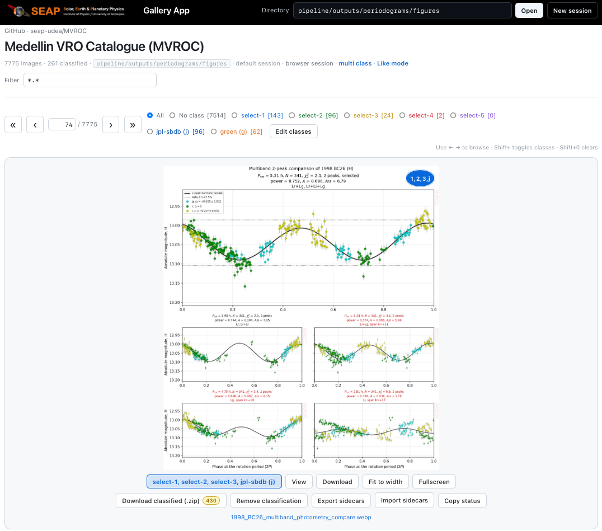
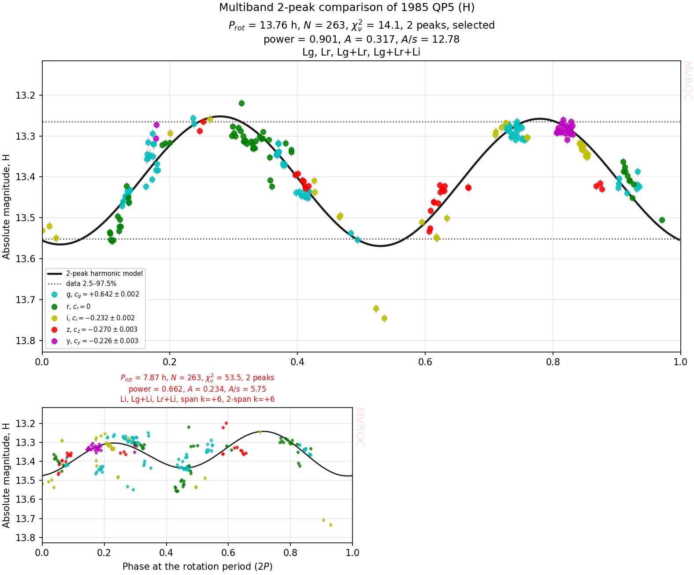
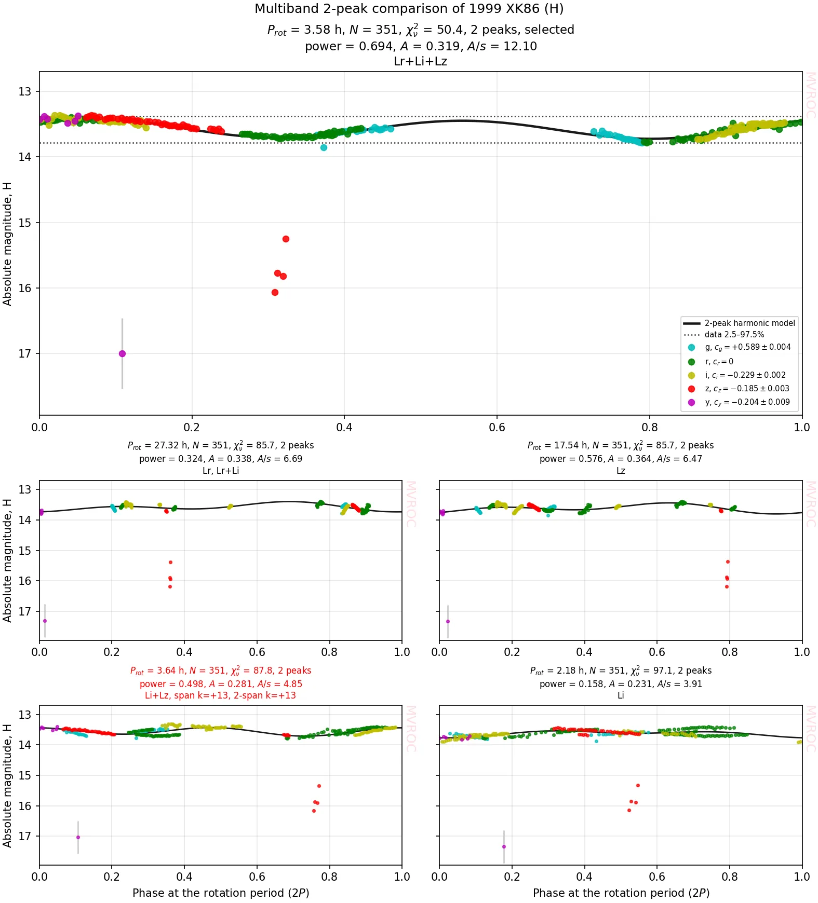
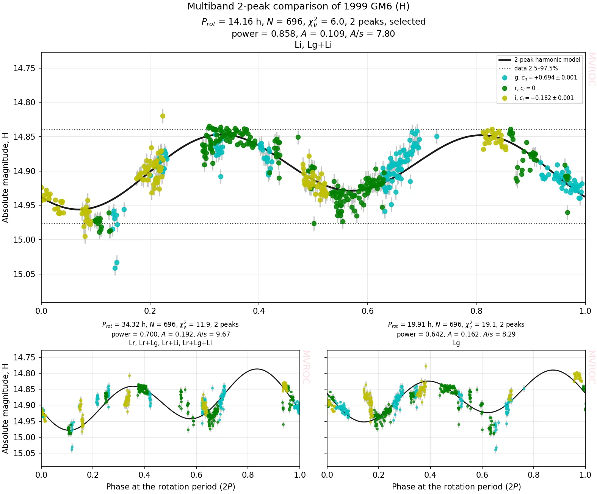
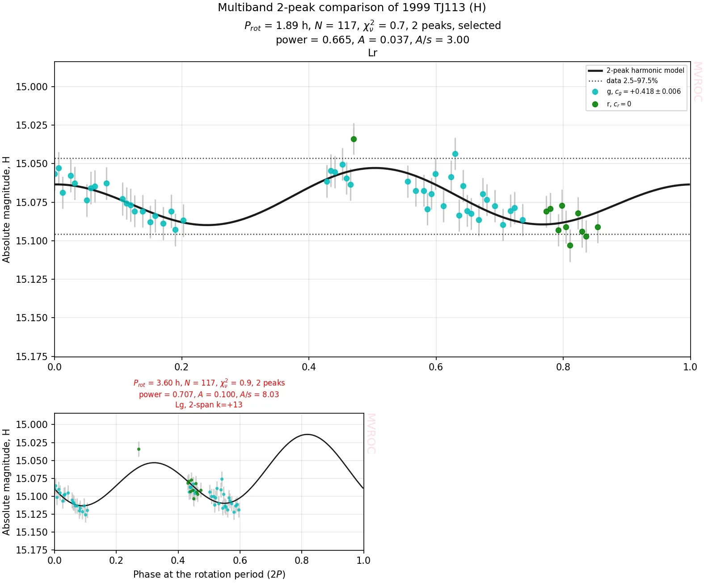
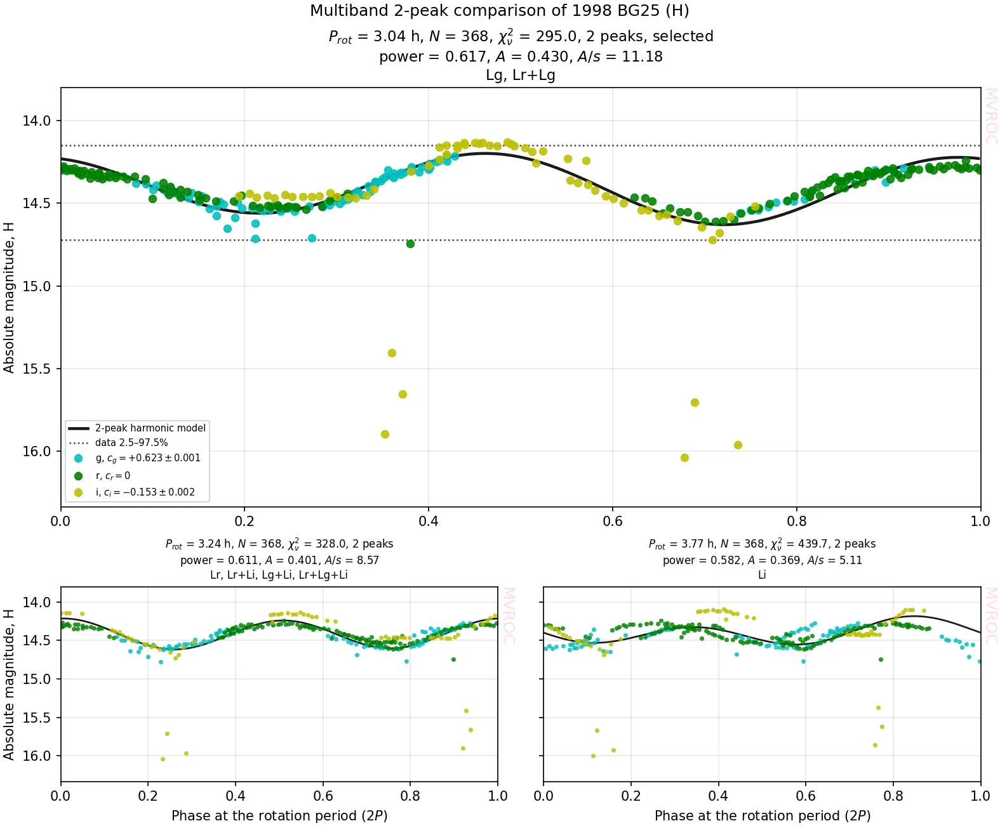
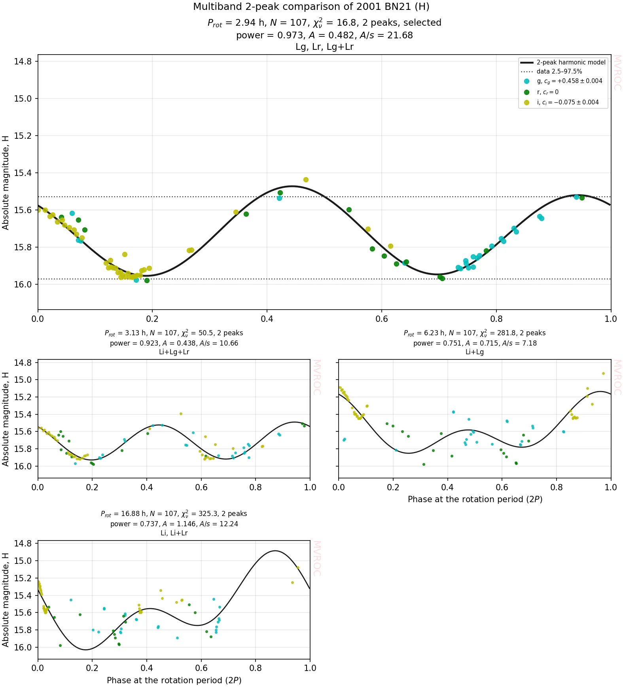

# Clasificación visual — periodograms (multiband compare)

Guía para marcar **soluciones** en la galería de figuras
`*_multiband_photometry_compare.webp` (7775 asteroides) con la
[Gallery App](https://seap-udea.github.io/gallapp/).

Abre tu enlace de inicio (tabla al final) y trabaja en el rango asignado.

---

## Cómo es la página

Lectura rápida del pantallazo:

1. **Arriba** — carpeta del repo, filtro y contador (`7775 images · … classified`).
2. **Navegación** — `«` `<` casilla `n / 7775` `>` `»`, o teclas **←** / **→**,
   para cambiar de asteroide.
3. **Filtros de clase** — *All*, *No class*, `select-1`…`select-5`, `jpl-sbdb (j)`,
   `green (g)`. Sirven para revisar solo un tipo de etiqueta.
4. **Figura central** — el compare multiband. Arriba el panel **1** (solución
   *selected* del algoritmo); abajo los paneles **2**, **3**, … en orden.
5. **Badge** (esquina de la figura) — clases ya puestas en esa imagen
   (p. ej. `1, 2, 3, j`).
6. **Abajo** — botones de la imagen (*View*, *Download*, …) y, importante,
   **Export sidecars** / **Import sidecars** y *Download classified*.

A la derecha del listado de clases suele aparecer el recordatorio:

> Use ← → to browse · Shift+ toggles classes · Shift+0 clears

---

## Teclas y navegación

| Acción | Cómo |
|--------|------|
| Asteroide anterior / siguiente | **←** / **→** (o botones `<` `>`) |
| Ir al primero / último | `«` / `»` |
| Marcar o quitar una clase | **Shift + tecla de la clase** (toggle) |
| Quitar todas las clases de la imagen | **Shift + 0** |
| Filtrar la galería por una clase | clic en el radio *select-1*, *green*, etc. |

### Clases de solución (tu trabajo principal)

| Shift + | Clase | Significado |
|--------:|-------|-------------|
| `1` | select-1 | Panel grande de arriba |
| `2` | select-2 | Primer panel pequeño (abajo, izq.) |
| `3` | select-3 | Siguiente panel |
| `4` | select-4 | Siguiente |
| `5` | select-5 | Siguiente |

Puedes marcar **varios** paneles si varios pliegan bien.

**Toggle:** si pulsas otra vez **Shift + la misma tecla**, **se quita** esa
clase de la imagen. No hace falta *Remove classification* para un solo tag.

### Clases de literatura (ya rellenadas en muchos casos)

| Shift + | Clase | Uso |
|--------:|-------|-----|
| `j` | jpl-sbdb | Periodo SBDB / JPL |
| `g` | green | Greenstreet et al. |

No las borres si ya están. En tu rango céntrate en `1`–`5`.

---

## Qué mirar en cada figura

- El panel de arriba es el candidato principal; los de abajo son alternativas.
- Marca un panel cuando el **patrón de brillo se repite** a lo largo de la fase
  (dos máximos típicos de un elipsoide) y los puntos de las bandas siguen esa
  forma.
- **Si la curva armónica negra no ajusta del todo, pero ves el patrón
  repetirse, márcalo igual como bien folded.** El modelo es una guía; el ojo
  manda.

Ejemplo (2025 MA19): el modelo no abraza cada punto, pero la onda de brillo es
clara → conviene marcar el panel (p. ej. `select-1`).

- Si **ningún** panel sirve, no marques `1`–`5`.

Para ver cómo se etiquetó antes, filtra la galería por **select-1** (radio
`select-1` arriba) o abre
[ejemplos ya en select-1](https://seap-udea.github.io/gallapp/?repo=seap-udea%2FMVROC&dir=pipeline%2Foutputs%2Fperiodograms%2Ffigures&session=&multi=true&n=0&class=1&likes=all&filter=*.*&grid=true&preview=true&strip=66&persist=session).

---

## Ejemplos de aspecto (clasificación de calidad previa)

Antes se usaban etiquetas de **calidad del fold** (clean-fold, scattered, …).
Ya no hay que ponerlas en gallapp; sirven para entrenar el ojo: qué se ve bien
y qué se ve regular, pero **aún así** a veces el periodo se marca en `1`–`5`.

### Clean folding

Poca dispersión; los puntos siguen de cerca el modelo de dos picos.

### Scattered folding

Más ruido / χ² alto; la forma de rotación sigue legible.

### Phase-incomplete

Solo se cubre un tramo de la rotación (huecos grandes en fase).

### Low-amplitude

Amplitud pequeña; la rotación aún se intuye (a menudo rotadores rápidos).

### Misaligned

Zero-points / colores desordenados (p. ej. una banda muy desviada); la forma
de rotación puede seguir clara.

### Undersampled

Pocas observaciones o muestreo irregular; el fold es más frágil.

---

## Guardar el trabajo

- Si **siempre usas el mismo navegador** en el mismo equipo, gallapp **guarda
  la clasificación en la sesión** y al volver deberías ver tus marcas.
- Si vas a **cambiar de navegador, de máquina o limpiar datos del sitio**,
  antes de irte pulsa **Export sidecars**: descarga un **ZIP** con las
  selecciones.
- En el otro navegador (o tras reiniciar), abre la misma galería y pulsa
  **Import sidecars** con ese ZIP para recuperar las marcas.
- Cuando termines un bloque (o el día), exporta otra vez por si acaso.
  *Download classified (.zip)* también empaqueta lo clasificado para revisión.

---

## Reparto del trabajo (desde la figura 1000)

Los índices **0–999** ya se revisaron. Desde **1000** hasta el final se reparte
así (abre el enlace de tu fila y avanza con → hasta cubrir tu rango):

| Persona | Rango (índice) | Figuras | Enlace de inicio |
|---------|----------------|--------:|------------------|
| Nico | 1000 – 2693 | 1694 | [Empezar](https://seap-udea.github.io/gallapp/?repo=seap-udea%2FMVROC&dir=pipeline%2Foutputs%2Fperiodograms%2Ffigures&session=&multi=true&n=1000&class=all&likes=all&filter=*.*&grid=true&preview=true&strip=66&persist=session) |
| Juanita | 2694 – 4387 | 1694 | [Empezar](https://seap-udea.github.io/gallapp/?repo=seap-udea%2FMVROC&dir=pipeline%2Foutputs%2Fperiodograms%2Ffigures&session=&multi=true&n=2694&class=all&likes=all&filter=*.*&grid=true&preview=true&strip=66&persist=session) |
| Vale | 4388 – 6081 | 1694 | [Empezar](https://seap-udea.github.io/gallapp/?repo=seap-udea%2FMVROC&dir=pipeline%2Foutputs%2Fperiodograms%2Ffigures&session=&multi=true&n=4388&class=all&likes=all&filter=*.*&grid=true&preview=true&strip=66&persist=session) |
| Angie | 6082 – 7774 | 1693 | [Empezar](https://seap-udea.github.io/gallapp/?repo=seap-udea%2FMVROC&dir=pipeline%2Foutputs%2Fperiodograms%2Ffigures&session=&multi=true&n=6082&class=all&likes=all&filter=*.*&grid=true&preview=true&strip=66&persist=session) |

Si dudas en un objeto, déjalo sin `1`–`5` y anótalo para revisión conjunta.
Al cerrar, **Export sidecars**.
